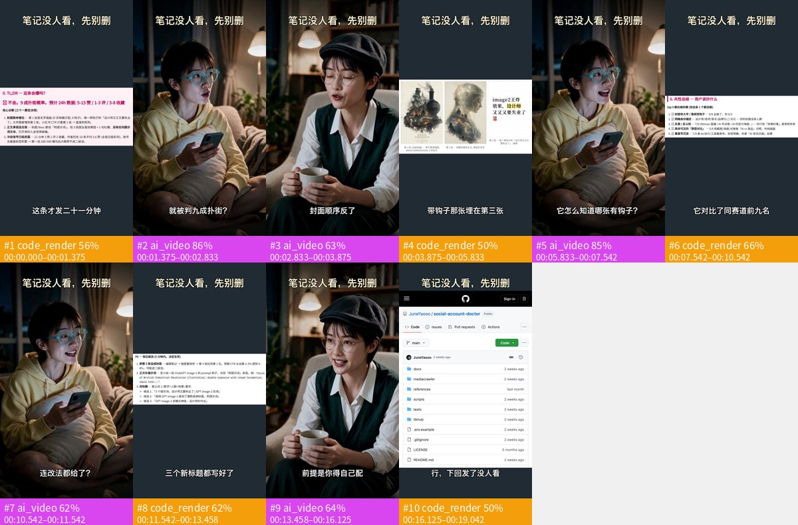
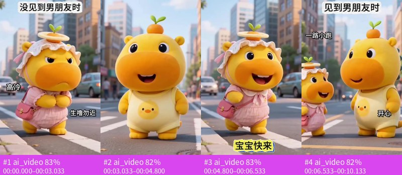

# rea-video — Reverse Engineer Any Video

> 拿到一条视频，逐镜头判断它**是怎么做出来的**：实拍、AI 生成、3D 渲染、代码渲染、录屏、静态图推拉，还是混合；字幕和贴片是不是后期叠加的；**哪些是用户真实素材**（实拍、截图、录屏、照片）；**声音怎么做的**（人声、BGM 的 BPM/调性/段落、音效、是否卡点），以及**音乐/人声/音效是 AI 生成的还是现成的**（先看视频形式：AI 音乐 MV 多为 AI 歌，普通配乐多为曲库）。实拍镜头（口播、桌拍、开箱、vlog）还会按维度拆**怎么拍、怎么打光、怎么剪**：形式、景别和机位角度、手持还是支架、机位数，主光方向/光比/软硬/色温/轮廓光，剪气口、跳切和插入素材的节奏，并给出拍摄方案和器材清单；维度可插拔（`rea_video/aspects/`）。每个结论都附可复查的证据。然后对其中的 AI 类镜头，交给 [capsule-cinema](https://github.com/JuneYaooo/cheap-claude-video) 复刻。

**给 Agent 用**：`scripts/install_skill.sh` 会把 [`skills/rea-video`](skills/rea-video/SKILL.md) 链接到 Claude Code、Codex 等 agent 的 skills 目录。Agent 会按 Skill 里的流程拆解、复核低置信镜头、按模板交付。

## 安装

需要 Python ≥ 3.10 和 ffmpeg（macOS：`brew install ffmpeg`；Ubuntu：`apt install ffmpeg`）。

```bash
git clone <本仓库> && cd rea-video
pip install -e ".[ocr]"          # numpy / opencv / pillow / pyyaml / onnxruntime + 可选 OCR
rea-video --help
bash scripts/install_skill.sh    # 可选：装 CLI 并把 skill 链接到 ~/.claude/skills、~/.codex/skills、~/.agents/skills
```

首次拆解会自动下载约 67 MB 的人声分离模型（`~/.cache/rea-video/models`）。一条 30 秒视频不开 VLM 约 1 分钟出结果。

装好 skill 后，在 Claude Code / Codex / zcode 里直接说"帮我拆解这条视频 xxx.mp4，看看是不是 AI 做的"即可，agent 会按 [SKILL.md](skills/rea-video/SKILL.md) 的流程跑：先看记忆 → 拆解 → 看图复核 → 按模板交付。

## 快速开始

```bash

# 1. 只做确定性取证（离线、免费）
rea-video decompose ref.mp4 -o out/ref

# 2. 加 VLM（建议，不强制）：让多模态大模型看画面，实拍/AI/3D 判断更准
#    任意 OpenAI 兼容的多模态模型都行，模型可写多个做备选
export REA_VLM_BASE_URL=https://.../v1 REA_VLM_API_KEY=... REA_VLM_MODEL=gemini-2.5-pro,gpt-4o
rea-video decompose ref.mp4 -o out/ref --vlm
#    或复用 capsule-cinema 的配置：rea-video --env-file ~/code/github/capsule-cinema/.env decompose ref.mp4 -o out/ref --vlm
#    VLM 调用全部失败时不会中断，报告和 `rea-video summary` 的 "VLM:" 一行会写明"全部调用失败，等同未开"

open out/ref/report.html

# 3. 没有 VLM，但 agent 自己能看图（zcode、Claude Code 等多模态 agent）：让 agent 当 VLM
rea-video review out/ref             # 生成逐镜看图任务和答案模板
rea-video apply-review out/ref --by zcode   # agent 填完答案后并入结论和报告

# 4. 用户纠正和偏好会被记住（存在 ~/.rea-video，可用 REA_VIDEO_HOME 改位置）
rea-video correct out/ref --shots 3 --label still_motion --note "这是定格动画"
rea-video prefs vlm on && rea-video prefs --note "报告尽量短"
rea-video memory

# 只剥离声音：stems/original.wav（原声）、vocals.wav（人声干声）、music.wav（配乐）
rea-video stems ref.mp4 -o out/ref
```

输出示例（混合片）：

```
结论：混合制作：代码/模板渲染 59% + AI 生成视频 41%；叠加层：字幕、标题（代码/剪辑软件合成）
#1 00:00.000 1.38s 代码/模板渲染 → R01 Remotion 重建
#2 00:01.375 2.50s AI 生成视频（24fps 源、无传感器噪声…）→ R07 首尾帧生成（capsule-cinema）
...
```

## 效果

详细方法见 [docs/decompose.md](docs/decompose.md)，全部数字和复现命令见 [eval/RESULTS.md](eval/RESULTS.md)。

**制作方式判断**（按时长加权的镜头准确率）。标注集：labels（调参集）、holdout + holdout2（16 条留出视频）、articles（10 条文章视频，开发集）：

| 配置 | labels | holdout | holdout2 | articles |
|---|---|---|---|---|
| 只用工具（离线、免费） | 99.9% | 99.6% | 99.8% | 88.6% |
| + VLM（Gemini 3.1 Pro） | — | 99.6% | 99.8% | 99.6% |
| + agent 看图复核（zcode） | — | 99.6% | 99.8% | 100% |
| + VLM + agent | — | 99.6% | 99.8% | 98.8% |

- 平时拍的、没转码的视频，只用工具就基本够；**平台下载的转码视频**噪点证据被抹掉，看图（VLM 或能看图的 agent）能把 88.6% 提到 99% 以上。
- 拿不准时会说拿不准：转码视频里，既没有 AIGC 标识、也没有手机原生 30fps 证据的"AI / 实拍"镜头，置信度封顶 0.7，结论写"证据不足，待确认"。
- **真实素材**（实拍、截图、录屏、照片）：97.6% / 99.6% / 98.1%（labels / holdout / holdout2），articles 100%。
- **切点**：F1 1.0。

**换一个 agent 只靠 Skill 盲测**（[eval/agent_test](eval/agent_test/README.md)）：zcode（GLM，能看图）不改代码、不上网，13 条文章视频按人工评分 19/22，只用工具 18/22，上一代流程 14/22；16 条留出视频里完成的 15 条有 14 条结论正确（1 条因 zcode 自身报错中断）。开 VLM + 看图复核时，每条视频约 6–20 分钟。

**声音**：默认剥成原声 / 人声干声 / 配乐三条轨（UVR MDX-Net，TTS + BGM 分离 SDR ≈ 19.7 dB）；人声、BGM 有无，以及 BPM、调性在带真值的样本上全对。音乐来源（AI 生成还是曲库）只对了 2/5：AI 工作流里 Suno 生成的垫底 BGM 会被判成"倾向曲库"。混音里的音效只能靠 VLM 听。

**局限**：
- 样本少：带制作方式标注的视频共 41 条（调参 15、留出 16、转码开发集 10），实拍和定格动画尤其少。最近几条融合规则就是在这些数据上选出来的，需要新视频复核。可以用 `rea-video memory --export-labels` 把用户纠正过的视频导出成新的评测样本。
- 转码后的"实拍还是 AI"仍然是最难的一类：现在只能如实标"待确认"，还不能判得更准。
- 单开 VLM 时，Gemini 会很自信地把卡通 AI 判成 3D、把文字卡片判成截图；工具已做限制（只有一个看图来源时，不能推翻工具有把握的 AI / 实拍判断）。VLM 服务不稳定时会自动换备用模型，全部失败也不会中断。

## 案例

两条 `rea-video decompose` 的真实输出（未开 VLM，仅确定性取证）。拼帧图每格一个镜头，底部彩条是逐镜判断：制作方式、置信度、时间范围；完整产出还有 `breakdown.json`、`report.html/md`、每镜首尾帧和声音拆解图。

### 混合片：代码渲染 + AI 生成 + 真实素材（19s · 10 镜）



**结论**：代码/模板渲染 59% + AI 生成视频 41%；叠加层：文字标注、字幕、标题（代码/剪辑软件合成）；声音：人声 + BGM 121.6 BPM + 音效 1 处。

- **真实素材单独标出**：录屏 8.2s、界面截图 2.9s，复刻时原样保留、不重新生成
- 代码渲染镜头给出文字轨和版式 → Remotion 重建；AI 镜头 → capsule-cinema 首尾帧生成；「快速开始」里的输出示例就是这条

### 纯 AI 生成（10s · 4 镜）



**结论**：AI 生成视频 100%（逐镜置信度 82–83%）；声音：人声 + BGM 123.0 BPM（C major，置信 0.88）。

- 元数据直接检出 **AIGC 生成标识**（generator 字段）
- 4 镜平均 2.53s，33% 的切点落在 BGM 节拍上（随机约 26%）

## 和 capsule-cinema 一起复刻

```bash
CC=~/code/github/capsule-cinema; PY=$CC/.venv/bin/python
rea-video remake-plan out/ref/breakdown.json --capsule-root $CC                  # AI 类镜头 → 首尾帧生成任务
$PY integrations/capsule_cinema/run_remake.py --jobs out/ref/remake/jobs.json    # 调 capsule-cinema 生成（会计费，可先 --dry-run）
rea-video assemble out/ref/breakdown.json out/ref/remake/results.json            # 按原时间线拼回 + 对比片
$PY integrations/capsule_cinema/to_capsule.py --breakdown out/ref/breakdown.json --capsule-root $CC --capsule-name my_remake
```

- 静态图推拉和静帧：不调模型，本地用测得的缩放和平移参数精确重建。
- 代码渲染和录屏：报告给出文字轨和版式，用 Remotion 重建。
- `to_capsule.py`：通过 capsule-cinema 自带的 `tool_factory` 注入拆解结果，生成可复用的配方草稿，不需要改 capsule-cinema 的代码。

见 [integrations/capsule_cinema/README.md](integrations/capsule_cinema/README.md)。

## 命令

| 命令 | 作用 |
|---|---|
| `decompose VIDEO [--vlm] [--no-ocr]` | 拆解，输出 breakdown.json、report.html/md、storyboard.jpg、每镜首尾帧 |
| `review OUT_DIR` | 给能看图的 agent 生成逐镜看图任务（review_tasks.json）和答案模板（review_answers.json） |
| `apply-review OUT_DIR [ANSWERS] [--by NAME]` | 把 agent 看图的答案和确定性结果融合，重写 breakdown.json 和报告 |
| `correct OUT_DIR --shots N --label L [--real yes/no] [--note]` | 用户指出判错：改正结论和报告，并记入记忆（以后同一文件自动套用，同类镜头复核时提示） |
| `prefs [KEY VALUE] [--note TEXT]` | 用户偏好：默认引擎、是否默认开 VLM、VLM 配置文件、复核者名字、给 agent 的自由文字说明 |
| `memory [--export-labels YAML]` | 看记住了什么（偏好、常见纠正类型）；把纠正导出成评测样本 |
| `probe VIDEO` | 只看元数据线索（拍摄设备、AIGC 隐式标识、C2PA、编辑器签名） |
| `summary breakdown.json` | 紧凑打印结论，标出需要复核的低置信镜头 |
| `tiles VIDEO --start --end --every` | 按时间抽帧拼图，近距离复核 |
| `eval labels.yaml` | 在带标注的样本上评测准确率和切点 F1 |
| `capsule breakdown.json` | 导出 capsule-cinema 的视频分析 JSON |
| `remake-plan` / `assemble` | 生成复刻任务、拼回成片 |

## 工作流（设计目标；目前完成到拆解和 AI 镜头复刻）

```
Ingest ─► Decompose ─► Video IR ─► Plan ─► Reconstruct ─► Verify ─► Remix
 导入      拆解/拉片     源码        路由     重建           差分验证   批量改写
```

| 阶段 | 状态 |
|---|---|
| Ingest、Decompose、Video IR（`breakdown.json`） | 已可用，即本仓库主体 |
| Plan | 已可用：每镜给出复刻路线；AI 类镜头生成 capsule-cinema 任务 |
| Reconstruct | 部分可用：AI 镜头交给 capsule-cinema，静态图推拉本地重建；代码层只给出文字轨和版式，还不生成 Remotion 工程 |
| Verify | 部分可用：`assemble` 拼回成片并输出对比视频；自动打分还没做 |
| Remix | 未开始 |

1. **Ingest（导入）**：probe、抽帧、分离音轨。
2. **Decompose（拆解）**：确定性 CV 和 VLM 分工。CV 负责精确的时间和位置：切镜、OCR 轨迹、分割、相机运动、节拍、字级对齐；VLM 负责语义：镜头意图、表演、风格。
3. **Video IR（源码）**：时间线 → 轨道 → 片段。每个片段标注渲染方式（`code` / `gen` / `footage` / `audio`），并附参数、证据和 unknowns。
4. **Plan（路由）**：读取 [能力地图](capabilities/README.md)，把每个生成单元路由到原语和模型，输出 Shot Recipe，包含成本预估和需要用户确认的节点。
5. **Reconstruct（重建）**：代码层用 Remotion 等渲染，生成层调用模型，音频层用 TTS、音乐、音效，最后合成。
6. **Verify（验证）**：检查切点对齐、OCR 文本一致性、布局 IoU、感知相似度、主体一致性、运动轨迹、节拍和口型，输出 scorecard，由 agent 循环修复得分最差的镜头。
7. **Remix（改写）**：换人、换货、换文案、换语言、换画幅时，只重新渲染受影响的层。

## 两种模式

- **fidelity（高保真复刻）**：目标是结构、节奏、运镜、文字和动效逐项对齐，用分数说话。
- **adapt（创意改编）**：保留原片"为什么有效"的关系，比如钩子、揭示、节奏，内容按新主题重写。

两种模式可以按层混用。例如节奏和运镜走 fidelity，人物和文案走 adapt。

## 和同类方案的区别

详见 [docs/vs-hypit.md](docs/vs-hypit.md)。一句话：Hypit 擅长"导演式改编口播类视频"，OiiOii 擅长"一键托管复刻"。rea-video 要做的是**有证据、能验证、能路由到任何模型**的逆向工程。

## 合法使用

rea-video 用于学习视频的结构、节奏和制作方法，并用**你有权使用的素材**重新制作。请勿直接搬运他人的画面、音乐、角色或肖像。投放时请遵守平台规则和当地的 AI 生成内容标识要求。

## 灵感来源

灵感来自 [REA（Reverse Engineer Anything）](https://github.com/morluto/rea)：从现象追到实现，结论附证据，用可测量的方式验证。

## 社区

欢迎来 [linux.do](https://linux.do/) 交流使用体验、拆解案例和复刻思路。
