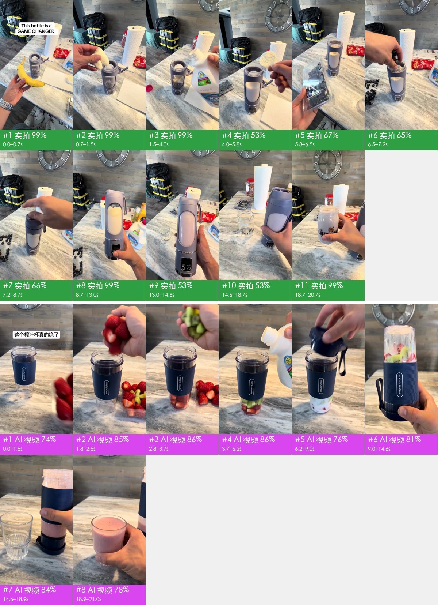
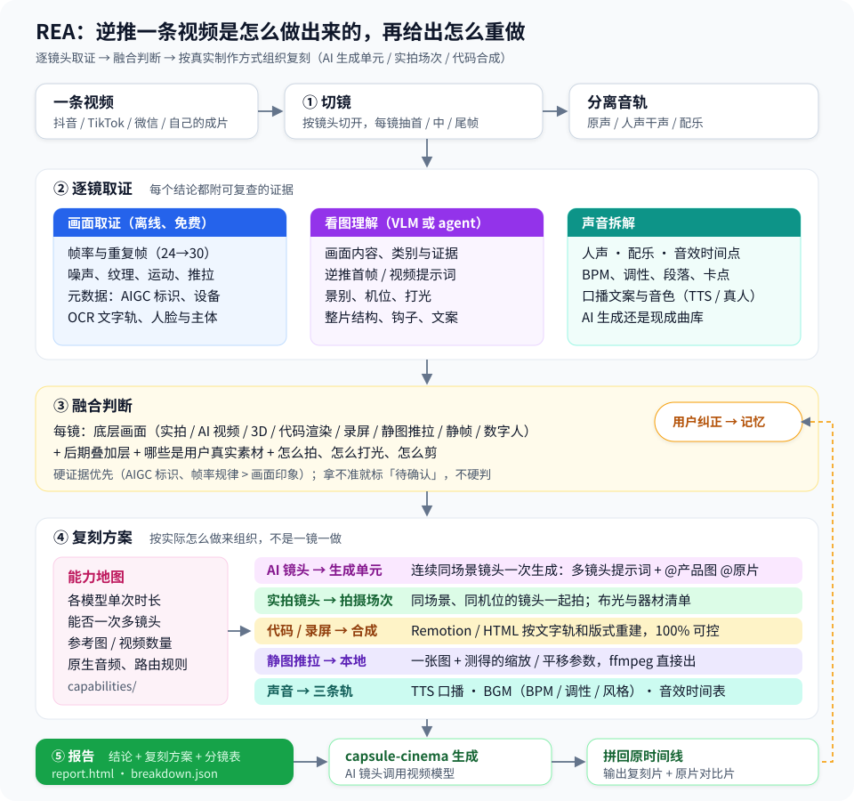
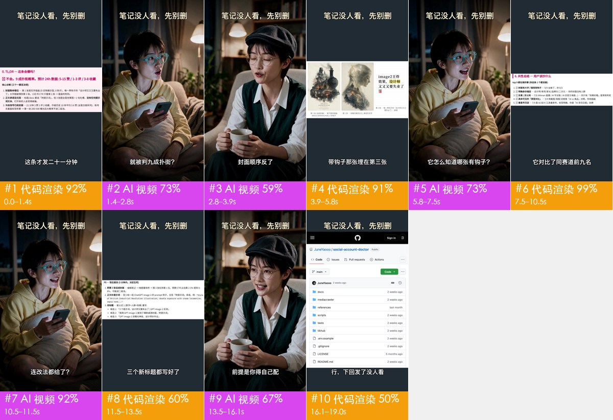
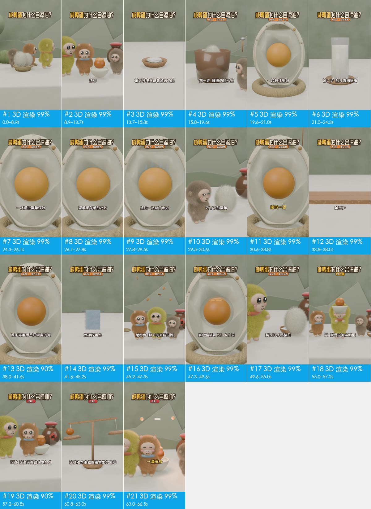
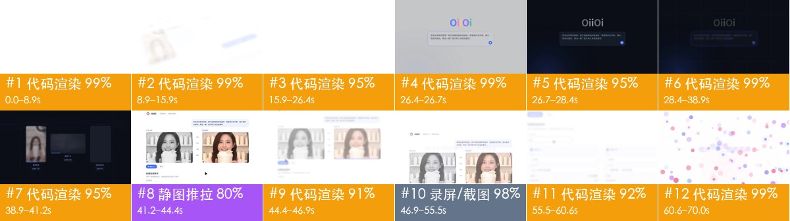
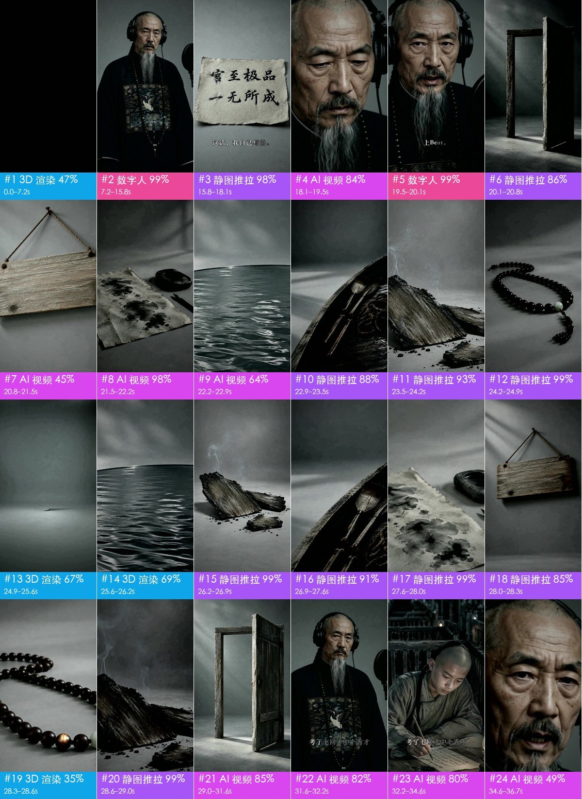

# rea-video：看懂一条视频是怎么做的，再照着做一条

给它一条视频（抖音、TikTok、广告片、MV 都行），它会逐个镜头告诉你：

- 这一镜是**实拍、AI 生成、3D 渲染，还是代码 / 模板做的**；
- 哪些是**真实素材**（录屏、截图、产品图），复刻时必须你自己准备；
- **声音**怎么配的：真人还是 AI 配音，BGM 是 AI 生成还是曲库，音效在哪里；
- **怎么重做一遍**：哪些镜头交给视频模型、提示词怎么写、一次能生成几个镜头；哪些要实拍、分几场拍；哪些用代码就能做。

每个结论都附可以复查的证据，拿不准的地方会标「待确认」，不硬猜。

## 30 秒看懂：一条实拍带货片和它的 AI 复刻版



上排是 TikTok 上的手机实拍原片，下排是别人用 AI 换了产品重做的版本。每一格是一个镜头，色条写着判断结果。rea-video 给出的结论：

| | 原片 | AI 复刻版 |
|---|---|---|
| 怎么做的 | 100% 手机实拍，真人口播 | 100% AI 生成（文件里带 AIGC 标识），AI 配音 |
| 怎么重做 | 1 个场景、2 个机位，一张台面一次拍完 | 8 个镜头合并成 3 次视频模型生成，附提示词 |
| 要准备什么 | 产品实物 | 产品参考图（杯身 Logo 要清楚） |

详细拆解见下面的[案例 1](#1-原片-vs-ai-复刻tiktok-实拍--换产品重做)。

## 适合谁

- **做内容的人**：看到爆款想做同款，先搞清楚哪些能用 AI 做、哪些得拍、成本大概多少。
- **做 AI 视频的人**：把参考视频拆成可以直接用的分批生成方案和提示词，不用一镜一镜去猜。
- **想判断真假的人**：一条视频是实拍还是 AI 生成，给出证据而不是感觉。

## 怎么用

不用自己敲命令，交给你的 AI 助手（Claude Code、Codex 等能运行命令的 agent 都可以）：

1. **安装**：对它说「安装 https://github.com/JuneYaooo/rea-video 」。它会自己装好（电脑上需要有 ffmpeg 和 Python 3.10 以上）。
2. **拆解**：把视频发给它，说「拆解这条视频，告诉我是怎么做的、怎么复刻」。它会拆解、自己看图复核没把握的镜头，最后给你结论和一份完整报告。
3. **复刻**（可选）：配合 [capsule-cinema](https://github.com/JuneYaooo/cheap-claude-video)，它可以把 AI 镜头交给视频模型生成，再拼回原来的时间线，输出复刻片和原片的对比。调用模型要花钱，它会先问你。

**建议配一个看图模型（VLM）**：Gemini、GPT-4o、豆包、Qwen-VL 等都可以，把接口配置告诉 agent 就行。配上之后实拍、AI、3D 分得更准，每个镜头还会反推出提示词。不配也能用。

想自己跑命令，见 [docs/cli.md](docs/cli.md)。

## 它是怎么判断的



1. **切镜头**：把视频按镜头切开，声音拆成人声、配乐、音效。
2. **取证据**：
   - 测画面：帧率规律、噪点、画面是不是整张图在推拉、文件元数据里有没有 AIGC 标识。
   - 看图：看图模型和 agent 看画面内容，例如手指、文字、物理细节对不对。
   - 听声音：BPM、调性，是唱还是说。
3. **综合判断**：硬证据（AIGC 标识、帧率）优先于"看起来像"。几方意见冲突时标出来，交给 agent 看图复核。
4. **出复刻方案**：按目标视频模型的实际能力来分，包括单次能生成多长、能不能一次出多个镜头、能吃几张参考图，所以是能直接照做的方案，不是一镜一个任务的清单。

## 案例

5 条都是开看图模型跑完整流程的结果，有分歧的镜头都经过 agent 看图复核。每格是一个镜头，色条写着制作方式、把握程度和时间；点「完整报告」能看到每个镜头的证据、提示词和复刻方案。

### 1. 原片 vs AI 复刻：TikTok 实拍 → 换产品重做

21 秒 · 原片 11 镜 / 复刻版 8 镜 · 拼帧图见上方

▶ [TikTok 原片](docs/cases/videos/v11_tiktok_original.mp4) · [AI 复刻版](docs/cases/videos/v12_oiioii_juicer_remake.mp4) · 📄 完整报告：[原片](docs/cases/v11/report.md) · [复刻版](docs/cases/v12/report.md)

**怎么做的**：
- 原片是手机第一视角实拍：原生 30fps、有传感器噪点、真人口播带现场声。
- 复刻版是 OiiOii 拿原片当参考、换成摩飞榨汁杯后用视频模型重做的：文件带 AIGC 标识，杯身 Logo 是乱码，配音是 AI 男声。它保留了原片的场景、机位和跳切节奏。

**怎么重做**：
- **原片按拍摄来组织**：1 个场景、2 个机位（近景 7 镜、特写 4 镜），每条前后多留 1 秒。
- **复刻版按生成来组织**：8 个镜头合并成 3 次生成（备料、搅打、倒出和成品），每次附产品参考图和原片片段，下一次用上一次的最后一帧开头。选不支持多镜头的模型（Seedance 2.0）要生成 8 次，换 Seedance 2.5 只要 3 次。

第一次生成的提示词（节选，报告里有完整版和英文版）：

```text
竖屏 9:16；正面柔光，偏冷，背景虚化。产品外观以 @图片1 为准，Logo 和细节保持一致。参考 @视频1 的动作、运镜和剪辑节奏。镜头之间硬切。
镜头1（0.0–1.8s）：固定俯拍机位，大理石桌面上放着蓝色便携榨汁杯，一只手将一透明盒新鲜红草莓轻轻放在榨汁杯右侧，随后手移出画面
镜头2（1.8–2.8s）：手松开，几颗草莓掉落进下方的蓝色榨汁杯中，镜头保持固定
镜头3（2.8–3.7s）：一只手将切块的绿色猕猴桃松开，猕猴桃块掉入杯中，杯子里已经有红色的草莓块
镜头4（3.7–6.2s）：一只手拿着白色塑料瓶，将牛奶平稳地倒入榨汁杯中，杯中液面逐渐上升
镜头5（6.2–9.0s）：手将杯盖扣紧并旋紧，随后单手拿起杯身完全倒转，杯中水果与牛奶向下沉降
```

### 2. 混合片：AI 人物对话 + 代码界面 + 真实录屏

19 秒 · 10 镜



▶ [原视频](docs/cases/videos/dual_role.mp4) · 📄 [完整报告](docs/cases/dual_role/report.md)

**怎么做的**：两个 AI 生成的角色在客厅里你一句我一句（5 镜），中间穿插 5 段代码做的界面，里面有真实录屏 8.2 秒、截图 4.8 秒；标题和字幕是后期加的。

**怎么重做**：5 个对话镜头虽然被界面隔开，但在同一个场景，**一次生成就够**（用两张角色参考图锁定长相），剪辑时再把界面插回去。5 段界面写成 1 个 Remotion 代码工程，录屏和截图用你自己的。

### 3. 3D 科普片：咸鸭蛋为什么会流油

67 秒 · 21 镜



▶ [原视频](docs/cases/videos/salted_egg.mp4) · 📄 [完整报告](docs/cases/salted_egg/report.md)

**怎么做的**：21 个镜头全是 3D 渲染（毛绒小动物角色 + 剖面原理动画），AI 女声旁白，曲库配乐，45% 的剪辑点卡在节拍上（随机剪大约 25%）。

**怎么重做**：两条路。
- 交给视频模型：21 个镜头合并成 10 次生成。
- **让大模型写 Blender 或 Three.js 代码**：角色只建一次模，每个镜头设好机位渲染，多角度一致性最好，改文案也只是改代码。这类科普片现在已经可以由大模型生成。

### 4. 代码 UI 动效：产品宣传片

70 秒 · 12 镜



▶ [原视频](docs/cases/videos/v10_oiioii_gen_coding_first.mp4) · 📄 [完整报告](docs/cases/v10/report.md)

**怎么做的**：OiiOii「视频复刻」功能的宣传片。83% 是代码做的动效（界面透视、文字缓动、粒子 Logo），12% 是录屏，1 镜是截图推拉；界面里播放的视频、Logo、截图是嵌入的真实素材。

**怎么重做**：**不需要视频模型**。写成 1 个 Remotion 代码工程，文字和界面完全可控，改文案只改数据，可以直接让大模型写。录屏用你自己的界面录。

### 5. AI 音乐 MV：歌是 AI 写的还是曲库的

165 秒 · 86 镜



（图为前 24 镜）▶ [原视频](docs/cases/videos/qing_mv.mp4) · 📄 [完整报告（86 镜）](docs/cases/qing_mv/report.md)

**怎么做的**：一首 AI 生成的说唱，画面全是生成的。
- 画面构成：白须老者对着麦克风对口型的数字人 16%，清代场景的 AI 视频 52%，3D 风格镜头 15%，静图推拉 17%。
- 音乐判为 AI 生成：整首不间断，人声是唱的，和视频同时结束。这条实际是 Suno 做的，判对了。
- 看图模型把好几个镜头说成"影视剧实拍"；agent 看图发现奏折上的小字是不成字的伪汉字，确认是 AI 生成。

**怎么重做**：
- 先按风格和 BPM 用 Suno 生成歌。
- 对口型镜头用人像 + 歌声驱动数字人。
- 其余 AI 镜头合并成 34 次生成。
- 19 个静图推拉镜头在本地做，不用调模型。

## 准不准

按镜头时长算的「制作方式」准确率（数字和复现方法见 [eval/RESULTS.md](eval/RESULTS.md)，判断方法见 [docs/decompose.md](docs/decompose.md)）：

| | 调参集（15 条） | 留出集（16 条） | 公众号转码视频（10 条） |
|---|---|---|---|
| 只用工具（离线、免费） | 99.9% | 99.6% / 99.8% | 88.6% |
| + 看图模型（Gemini） | — | 99.6% / 99.8% | 99.6% |
| + agent 看图复核 | — | 99.6% / 99.8% | 100% |

- 原始文件只用工具基本够。从平台下载的视频被二次压缩过，噪点证据没了，要靠看图把准确率拉回 99% 以上。
- 真实素材识别 97–99%，镜头切点全对。声音方面，有没有人声、有没有配乐、BPM、调性，在有标准答案的样本上全对。

**还做不好的**：
- 样本少：一共 43 条标注视频，实拍和定格动画尤其少。
- 「实拍还是 AI」在压缩过的视频上最难，看图模型也会看走眼，还会编理由（案例 1 原片里它说"挂钟数字乱码"，其实数字很清楚）。工具和它意见相反时会标「有分歧」交给 agent 复核，但最终要靠看图。
- 电影机或微单拍 24fps 再导出 30fps 的实拍，帧率痕迹和 AI 视频一样，只用工具时会标「待确认」等看图。
- 音乐是 AI 生成还是曲库，目前只对了 2/5。
- 复刻方案里的「分几次生成」是推荐分法，原作者实际怎么分的，多数时候看不出来。

## 合法使用

rea-video 用来学习视频的结构、节奏和做法，再用**你有权使用的素材**重新制作。请勿直接搬运他人的画面、音乐、角色或肖像。投放时请遵守平台规则和当地的 AI 生成内容标识要求。

案例 1、4 的视频来自 OiiOii 公众号文章（[文章 1](https://mp.weixin.qq.com/s/s7i_fQmwWo9SbRoV-KDZ9g)、[文章 2](https://mp.weixin.qq.com/s/aXhPx0eQu9ngYxuyvsFE4Q)），版权归原作者，仅作拆解演示。

## 更多

- [docs/cli.md](docs/cli.md)：命令行用法、和 capsule-cinema 的对接
- [capabilities/](capabilities/README.md)：各家视频 / 图像 / 音频模型的能力表，复刻方案按它选模型
- [docs/vs-hypit.md](docs/vs-hypit.md)：和 Hypit、OiiOii 的区别

## 灵感来源

来自 [REA（Reverse Engineer Anything）](https://github.com/morluto/rea)：从现象追到实现，结论附证据，用可测量的方式验证。

## 社区

欢迎来 [linux.do](https://linux.do/) 交流使用体验、拆解案例和复刻思路。
