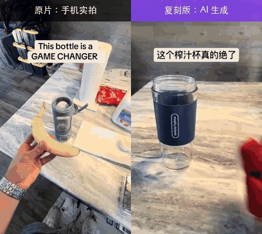
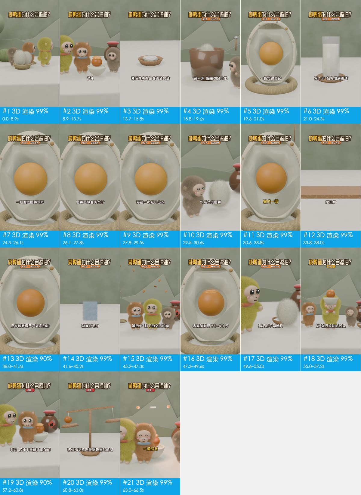
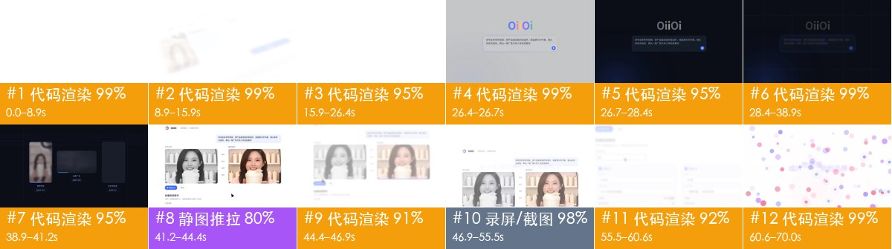
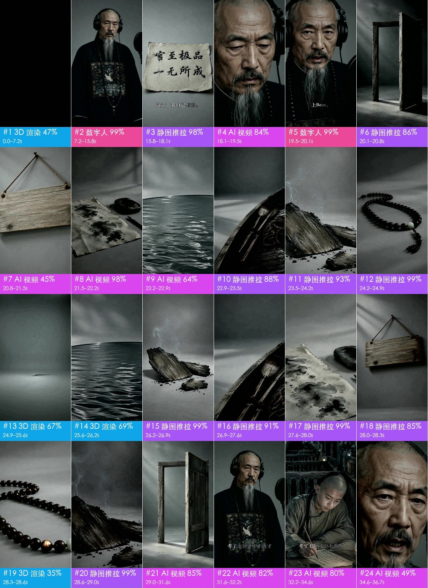
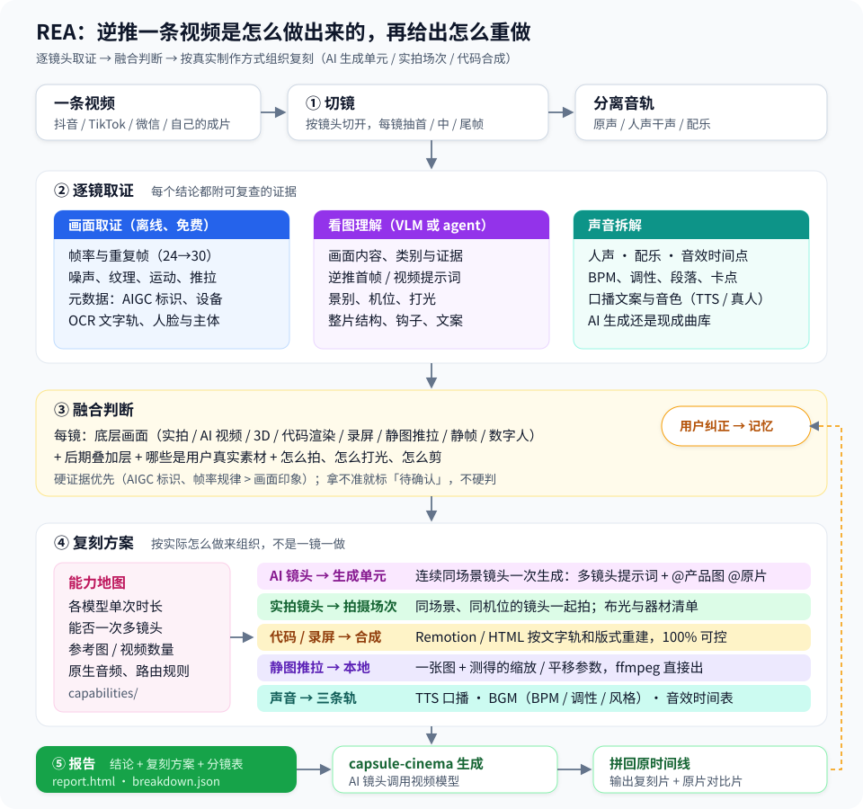

<div align="center">

# rea-video

Reverse-engineer any video.

Talking-head, tabletop, AI video, 3D, motion graphics, mixed edits: give it any of them,<br>
and it tells you shot by shot how the visuals, styled text, editing and audio were made, then gives you a plan to make one yourself.

[中文](README.md) | English

[](https://github.com/JuneYaooo/rea-video/stargazers)




Left: a TikTok ad shot on a phone. Right: someone's AI remake with a different product swapped in.<br>
rea-video's verdict: the left is all live footage, one set and two camera positions; the right is all AI-generated, and its 8 shots can be produced in 3 generations.

</div>

> The reports and detailed docs are currently in Chinese. Your agent can read them and answer in English.

## What it can break down

| Video type | Examples | What you get |
|---|---|---|
| Live footage | Talking-head, tabletop, handheld product demo, vlog, store visit | Setups and camera positions, framing, camera moves, lighting (12 setups with gear lists), color grade |
| AI video | Text/image-to-video, AI short drama, AI music video | Evidence, a reverse-engineered prompt per shot, how to batch into generations and which model to use |
| Avatar | A portrait driven by audio, lip-sync | Which shots are avatar shots, what portrait and audio you need |
| 3D / animation | Blender / C4D explainers, product animation, 2D animation, stop-motion | Whether to generate with a video model or render from 3D code |
| Code / template | Kinetic type, UI demos, charts, slide-style cards | Text, layout and motion timing, ready to rebuild as a Remotion project |
| Screen recording | Software tutorials, web demos | Which parts are real material you'll need to record yourself |
| Mixed / edits | AI characters + code UI + real screen capture; live footage with AI edits | Each shot judged separately, then reassembled on the original timeline |

For every video type it also breaks out:

- Editing packaging: a line-by-line caption timeline (exported as SRT / ASS); styled text (花字), titles, chapter cards and tracking labels with their color, outline, box, keyword highlight and pop / fade animations; stickers, GIFs, emoji and picture-in-picture windows with position, timing and whether they loop; which sound effects land on a text pop or sticker.
- Editing: cut points and pacing, jump cuts, punch-ins, multi-camera switching, cuts on pauses, share of inserted material, whether cuts land on the beat.
- Real assets: screen recordings, screenshots, product photos and other material you'll need to supply yourself.
- Audio: human or AI voice-over, AI-generated or library music, BPM and key, and when each sound effect hits.

Every call comes with evidence you can check. When it isn't sure, it says so. Full list: [docs/what-it-detects.md](docs/what-it-detects.md).

## Quick start

rea-video is built for AI agents. In Claude Code, Codex or any agent that can run commands, say:

```text
Install https://github.com/JuneYaooo/rea-video, then break down this video: /path/to/video.mp4
```

The agent installs the CLI, learns the workflow and runs the whole thing. You need ffmpeg and Python 3.10+.

You get:

- a one-line summary, e.g. "41% AI video + 59% code UI, 8 s of real screen recording, library music at 122 BPM";
- a remake plan, split into what to film, what to generate and what to code;
- a full `report.html` with per-shot frames, evidence, prompts, camera and lighting notes, and the audio breakdown.

A vision model (Gemini, GPT-4o, Doubao, Qwen-VL, etc.) is recommended: give the agent the endpoint and key. It makes live/AI/3D calls more accurate and writes a reverse-engineered prompt for every shot. Without one it still works; if your agent can see images, it will check the uncertain shots itself.

To run commands yourself, see [docs/cli.md](docs/cli.md). For how to film, generate and reassemble after you get the report, see [docs/replicate.md](docs/replicate.md).

## Examples

<table>
<tr>
<td width="50%" valign="top">
<a href="docs/cases.md#2-混合片ai-人物对话--代码界面--真实录屏"></a><br>
<b>Mixed-media clip</b> · 19 s · 10 shots<br>
AI characters talking + code-built UI + 8 s of real screen recording. The 5 dialogue shots are split up by UI segments but share one set, so one generation covers them.<br>
<a href="docs/cases/videos/dual_role.mp4">Video</a> · <a href="docs/cases/dual_role/report.md">Report</a>
</td>
<td width="50%" valign="top">
<a href="docs/cases.md#3-3d-科普片咸鸭蛋为什么会流油"></a><br>
<b>3D explainer</b> · 67 s · 21 shots<br>
All 3D, AI narration. Doable as 10 video generations, or have an LLM write Blender / Three.js code.<br>
<a href="docs/cases/videos/salted_egg.mp4">Video</a> · <a href="docs/cases/salted_egg/report.md">Report</a>
</td>
</tr>
<tr>
<td width="50%" valign="top">
<a href="docs/cases.md#4-代码-ui-动效产品宣传片"></a><br>
<b>Product promo</b> · 70 s · 12 shots<br>
83% code-driven motion graphics, 12% screen recording. No video model needed; one Remotion project does it.<br>
<a href="docs/cases/videos/v10_oiioii_gen_coding_first.mp4">Video</a> · <a href="docs/cases/v10/report.md">Report</a>
</td>
<td width="50%" valign="top">
<a href="docs/cases.md#5-ai-音乐-mv歌是-ai-写的还是曲库的"></a><br>
<b>AI music video</b> · 165 s · 86 shots<br>
Correctly flags the song as AI-generated (it was made with Suno). The vision model called some shots "live-action drama"; the agent spotted fake Chinese characters on a scroll and ruled them AI.<br>
<a href="docs/cases/videos/qing_mv.mp4">Video</a> · <a href="docs/cases/qing_mv/report.md">Report</a>
</td>
</tr>
</table>

Shot-by-shot details for every case, including the juicer clip above and its prompts, are in [docs/cases.md](docs/cases.md).

## Accuracy

How-it-was-made accuracy, weighted by shot duration:

| | Tuning set (15) | Holdout (16) | Re-encoded WeChat videos (10) |
|---|---|---|---|
| Tools only (offline, free) | 99.9% | 99.6% / 99.8% | 88.6% |
| + vision model (Gemini) | — | 99.6% / 99.8% | 99.6% |
| + agent visual review | — | 99.6% / 99.8% | 100% |

On original files the tools alone are mostly enough. Videos downloaded from platforms have been recompressed, which wipes out the noise evidence, so it takes a vision check to get back above 99%. Real-asset detection is 97–99%, and shot boundaries are all correct. Numbers and how to reproduce them: [eval/RESULTS.md](eval/RESULTS.md).

<details>
<summary>Known weak spots</summary>

- Small sample: 43 labeled videos, only 5 of them live footage. No eval videos yet for avatars, 2D animation, stop-motion or AI edits on live footage.
- The newer lighting setups (outdoor, low-key, high-key, colored ambient, product still life) and grade styles have only been tested on synthetic images; thresholds still need calibrating on real video. Lighting overall has been checked on just 2 talking-head videos.
- 2D animation, stop-motion and AI edits rely entirely on vision. Without a vision model, and with an agent that can't see images, they won't be detected.
- Stock live footage can't be told apart from your own; green-screen keying only shows up visually.
- Live vs AI is hardest on compressed video. Vision models get it wrong and sometimes invent reasons (on the juicer original it claimed "the wall clock digits are garbled"; they're perfectly clear). When tools and the model disagree, the shot is flagged for agent review, but the final call rests on vision.
- Live footage shot at 24fps on a cinema or mirrorless camera and exported at 30fps leaves the same frame-cadence trace as AI video, so with tools only it's marked uncertain until a vision check.
- AI vs library music: currently 2 of 5 correct.
- The "how many generations" split in the remake plan is a recommendation; usually you can't tell how the original creator actually split it.

</details>

## How it works



1. Split: cut the video into shots and separate audio into voice, music and effects.
2. Gather evidence: measure the frames (frame cadence, sensor noise, whether the whole image is panning as one plane, AIGC tags in metadata); look at the images (hands, text, physics); listen (BPM, key, singing vs speech).
3. Decide: hard evidence like AIGC tags and frame cadence outranks "looks like". Conflicts are flagged for the agent to review visually.
4. Plan the remake: batch shots according to what the target video model can actually do, such as max clip length, multi-shot support and how many reference images it takes.

Detection rules: [docs/decompose.md](docs/decompose.md). Full list of what it detects: [docs/what-it-detects.md](docs/what-it-detects.md).

## FAQ

<details>
<summary>How is this different from one-click remake tools like Hypit?</summary>

[Hypit](https://github.com/hypit-ai/hypit) aims to produce a new video directly: give it a reference, swap in your content, render. rea-video first works out how the original was made, then tells you which parts to film, generate or code. If you want a lookalike fast, Hypit is quicker. If you want to know how the original was made and how to remake it with the fewest generations, use rea-video. They work fine together.

| | Hypit | rea-video |
|---|---|---|
| Main output | A new video | Breakdown report and remake plan; renders with capsule-cinema |
| Understanding the source | Agent reads frame grids and writes an analysis | Measures frames first (cadence, noise, metadata, OCR), then vision; every call has evidence and a confidence level |
| Live vs AI | No dedicated step | Per-shot call across 10 production types, evaluated on 43 labeled videos |
| Live shots | — | Shooting plan: setups, camera positions, lighting, gear |
| Audio | Follows the voice-over and aligns to the script | Separates voice, music, effects; measures BPM and key, judges music source |

More detail (in Chinese): [docs/vs-hypit.md](docs/vs-hypit.md), based on Hypit's main branch as of 2026-10-29.

</details>

<details>
<summary>Do I need a vision model? What does it cost?</summary>

No. Tools-only mode is offline and free, and already accurate on original files. For recompressed platform downloads, add a vision model or use an agent that can see images; you pay whatever that service charges. Automatic video generation (capsule-cinema) does a free dry run first and only calls paid models after you confirm.

</details>

<details>
<summary>Can it remake the whole video automatically?</summary>

Partly. With [capsule-cinema](https://github.com/JuneYaooo/cheap-claude-video) installed, AI shots are generated and placed back on the original timeline automatically. Live shots you film from the shooting plan; code shots the agent writes as a Remotion project. See [docs/replicate.md](docs/replicate.md).

</details>

<details>
<summary>Can I just repost someone else's video?</summary>

No. rea-video is for learning a video's structure, pacing and techniques, then remaking it with material you have the rights to. Don't reuse other people's footage, music, characters or likeness. Follow platform rules and local AI-content labeling requirements when you publish.

</details>

## Docs

- [docs/what-it-detects.md](docs/what-it-detects.md): everything it detects (10 visual types, camera, lighting, grade, audio)
- [docs/replicate.md](docs/replicate.md): remaking from the report
- [docs/cases.md](docs/cases.md): case details
- [docs/cli.md](docs/cli.md): CLI usage and capsule-cinema integration
- [capabilities/](capabilities/README.md): capability tables for video / image / audio models, used to pick models for the remake plan
- [eval/RESULTS.md](eval/RESULTS.md): eval results

The docs are in Chinese for now.

## Community

Come share breakdowns and remake ideas on [linux.do](https://linux.do/) (Chinese-language community).

## Credits

Inspired by [REA (Reverse Engineer Anything)](https://github.com/morluto/rea): trace from what you see back to how it was made, back every claim with evidence, and verify by measurement.
